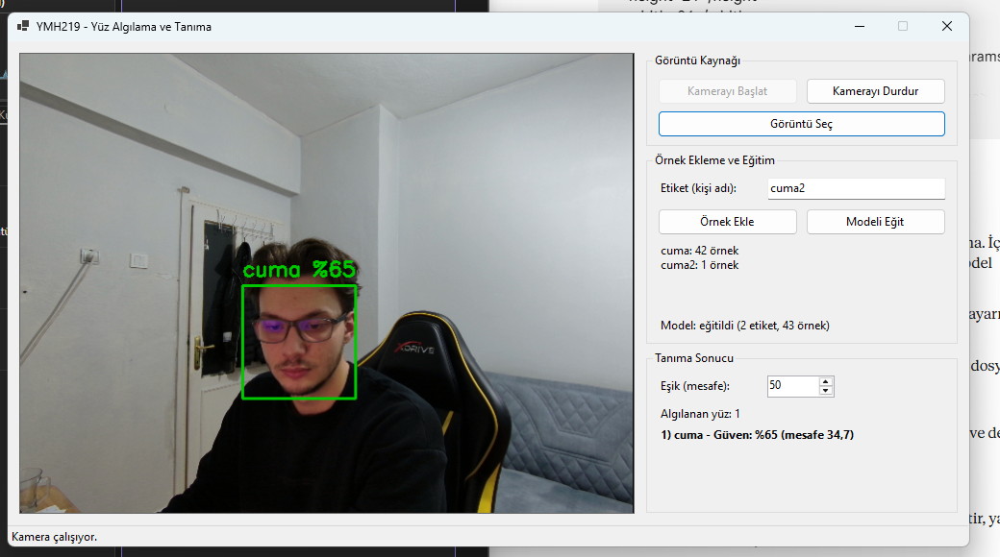
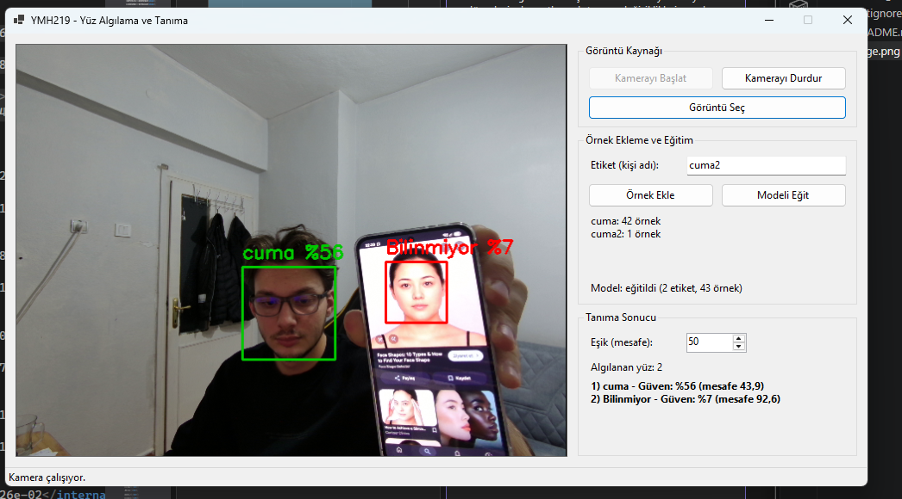

# YMH219-FaceRecognition

OpenCV tabanlı OpenCvSharp kütüphanesi ile geliştirilmiş bir Windows Forms uygulaması. Kameradan veya seçilen bir görüntü dosyasından yüzleri algılar, dikdörtgenle işaretler ve yerel olarak eklenen örneklerle eğitilen modele göre kişinin etiketini güven skoruyla birlikte gösterir.

Nesne Tabanlı Programlama (YMH 219) dersi ek uygulama ödevidir.

## Kullanılan Teknolojiler ve NuGet Paketleri

- C# / .NET, Windows Forms
- [OpenCvSharp4](https://www.nuget.org/packages/OpenCvSharp4/): OpenCV'nin .NET sarmalayıcısı
- [OpenCvSharp4.runtime.win](https://www.nuget.org/packages/OpenCvSharp4.runtime.win/): Windows x64 için yerel OpenCV dosyaları
- [OpenCvSharp4.Extensions](https://www.nuget.org/packages/OpenCvSharp4.Extensions/): `Mat` görüntüsünü `Bitmap` nesnesine çevirmek için
- Yüz algılama: Haar cascade (`haarcascade_frontalface_default.xml`, OpenCV deposundan alınmıştır)
- Yüz tanıma: LBPH (Local Binary Patterns Histograms)

## Kurulum ve Çalıştırma

1. Depoyu klonlayın:
   ```bash
   git clone https://github.com/CumaDogangithub/YMH219-FaceRecognition.git
   ```
2. `YMH219-FaceRecognition.sln` dosyasını Visual Studio ile açın.
3. NuGet paketleri ilk derlemede kendiliğinden geri yüklenir. Yüklenmezse çözüme sağ tıklayıp **Restore NuGet Packages** seçin.
4. **F5** ile çalıştırın.

Gereksinimler: 64 bit Windows, Visual Studio (.NET masaüstü geliştirme iş yükü) ve kamera modu için bir web kamerası.

## Kullanım

1. **Kamerayı Başlat** ile canlı görüntüyü açın veya **Görüntü Seç** ile bir fotoğraf yükleyin. Algılanan yüzler dikdörtgenle işaretlenir.
2. **Etiket** kutusuna kişinin adını yazın ve **Örnek Ekle** düğmesine basın. Her basışta o anki yüz bir örnek olarak kaydedilir. Kişi başına farklı açı ve ifadelerle en az 10 örnek önerilir.
3. En az iki farklı etiket için örnek ekledikten sonra **Modeli Eğit** düğmesine basın.
4. Tanınan yüzler yeşil, bilinmeyen yüzler kırmızı dikdörtgenle gösterilir. Etiket ve güven skoru hem görüntünün üzerinde hem de **Tanıma Sonucu** bölümünde yer alır.
5. Tanıma çok katı veya çok gevşek davranıyorsa **Eşik** değerini değiştirin. Değer küçüldükçe uygulama daha seçici olur.

## Temel Özellikler

- Kamera görüntüsünü veya seçilen resmi uygulama içinde gösterme
- Kamera Başlat / Durdur ve Görüntü Seç işlevleri
- Yüz algılama ve yüz bölgesini dikdörtgenle işaretleme (aynı karede birden fazla yüz desteklenir)
- İki veya daha fazla etiketle LBPH tabanlı yüz tanıma
- Tahmin edilen etiketi ve güven skorunu arayüzde gösterme
- Uygulama içinden örnek ekleme ve model eğitme ekranı
- Kamera veya model dosyası bulunamadığında kullanıcıyı hata mesajıyla bilgilendirme

## Proje Yapısı

| Dosya | Görevi |
|---|---|
| `Form1.cs` | Arayüz olayları; sınıfları bir araya getirir |
| `CameraService.cs` | Kamerayı açar, kare okur, kapatır |
| `FaceDetector.cs` | Haar cascade ile yüz algılar, yüzü tanıma için hazırlar |
| `FaceIdentifier.cs` | LBPH modelini eğitir ve etiket tahmin eder |
| `FaceDataset.cs` | Örnekleri diske kaydeder ve geri yükler |
| `FaceSample.cs` | Tek bir eğitim örneği (görüntü ve etiket) |
| `RecognitionResult.cs` | Tanıma sonucu (etiket, mesafe, güven yüzdesi) |
| `FrameAnnotator.cs` | Görüntü üzerine dikdörtgen ve etiket çizer |

## Ekran Görüntüleri





## Kapsam ve Gizlilik

Bu çalışma yalnızca ders kapsamında, yerel ve gönüllü örneklerle yapılmıştır. Eklenen yüz örnekleri yalnızca bilgisayardaki `dataset` klasöründe tutulur, hiçbir yere gönderilmez ve `.gitignore` ile depo dışında bırakılır. Uygulama izinsiz kimlik takibi veya gizli görüntü toplama amacıyla kullanılmamalıdır.

## Bilinen Sınırlamalar ve Geliştirme Notları

- Haar cascade yalnızca öne dönük yüzleri algılar; yandan görünen veya 60 pikselden küçük yüzler algılanmayabilir.
- LBPH ışık koşullarına duyarlıdır. Örnekler ile tanıma aynı ışıkta yapıldığında sonuç daha iyidir.
- Güven yüzdesi, LBPH mesafesinden `100 - mesafe` ile hesaplanan kaba bir göstergedir; gerçek bir olasılık değildir.
- Modelde olmayan bir kişi, eşik değeri yüksekse kayıtlı etiketlerden biriyle eşleşebilir.
- Görüntü üzerindeki etiketlerde Türkçe karakterler ASCII karşılıklarıyla yazılır (OpenCV yazı tipi kısıtı).
- OpenCvSharp 4.13 yalnızca 64 bit Windows'u destekler.
- Model her açılışta `dataset` klasöründeki örneklerden yeniden eğitilir; ayrı bir model dosyası kaydedilmez.

## Öğrenci

Ad Soyad - Öğrenci No
